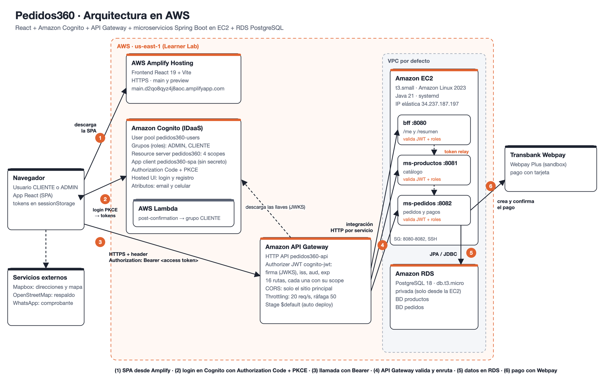

# Pedidos360

Proyecto de **Desarrollo Cloud Native I (DSY1107)**. Sistema de pedidos de comida con frontend React publicado en AWS Amplify, autenticación con Amazon Cognito como IDaaS, Amazon API Gateway como API Manager, microservicios Spring Boot en EC2 con PostgreSQL en Amazon RDS, mensajería asíncrona con un clúster RabbitMQ de dos nodos y streaming de eventos con un clúster Apache Kafka de tres brokers y tres Zookeeper, ambos levantados con docker compose.

| | |
|---|---|
| **Sitio** | https://main.d2qo8qyz4j8aoc.amplifyapp.com |
| **API** | https://w7q276u1ka.execute-api.us-east-1.amazonaws.com (todas las rutas exigen un JWT de Cognito) |
| **Usuarios de prueba** | Se entregan al docente por AVA o correo. También se puede crear una cuenta desde el sitio. |

> Por autorización del docente se usa **Amazon Cognito** en lugar de Azure AD (MSAL). El frontend está hecho en **React** en lugar de Angular: `react-oidc-context` (sobre `oidc-client-ts`) cumple el rol de MSAL con el flujo Authorization Code + PKCE, un guard de rutas (`ProtectedRoute`), un interceptor de axios que adjunta el token y la lectura de roles y scopes desde los claims.

## Arquitectura



```
Navegador (React en Amplify Hosting, HTTPS)
   │  1. login OIDC: Authorization Code + PKCE ──► Cognito (Hosted UI) ──► Lambda post-confirmation
   │  2. Authorization: Bearer <access token>
   ▼
API Gateway (HTTP API) ── authorizer JWT: firma, iss, audience, exp y scope por ruta ── CORS
   │  las 52 rutas se integran con el BFF
   ▼
BFF :8080 (único puerto expuesto) ── valida el JWT otra vez · autoriza por rol (administración solo ADMIN)
   │  /api/bff/me, /api/bff/resumen: los responde el BFF (resumen agrega productos + pedidos)
   │  el resto lo reenvía según el prefijo, con el mismo token (token relay):
   ├─ /api/productos/*  ──► ms-productos  :8081 ─┐
   ├─ /api/pedidos/*, /api/pagos/* ──► ms-pedidos :8082 ──► ms-productos (precios) · Transbank Webpay
   │                            │   └── RDS PostgreSQL (BD productos / BD pedidos)
   │                            │ publica eventos (AMQP, después del commit)
   │                            ▼
   │            ┌──── EC2 de mensajería · docker compose (IP privada) ───────────────┐
   │            │  RabbitMQ rabbit1 ⇄ rabbit2 (clúster, colas quorum replicadas)      │
   ├─ /api/notificaciones, /api/comprobantes, /api/auditoria, /api/mensajes-fallidos   │
   │            │      ──► ms-notificaciones   :8084  consumidores y listeners de DLQ ──► RDS (BD mensajeria)
   ├─ /api/mensajeria/* ──► ms-mensajeria-admin :8083  crea/elimina colas, exchanges, bindings
   │            └─────────────────────────────────────────────────────────────────────┘
   │                            │ ms-pedidos también publica cada hecho en Kafka (key = pedidoId, acks=all)
   │                            ▼
   │            ┌──── EC2 de streaming · docker compose (IP privada) ─────────────────┐
   │            │  Zookeeper ×3 (ensemble) · Kafka kafka1 kafka2 kafka3 · Kafka UI :8090│
   │            │  pedidos.actividad ──► analitica-ventas ──► ventas.metricas ──► tablero-ventas
   │            │                   └──► seguimiento-pedidos                           │
   ├─ /api/analitica/*  ──► ms-analitica       :8085  consumer groups, métricas y seguimiento
   └─ /api/streaming/*  ──► ms-streaming-admin :8086  tópicos, configuraciones, consumer groups, lag
                └─────────────────────────────────────────────────────────────────────┘
```

El JWT se valida tres veces (defensa en profundidad): API Gateway, el BFF y el microservicio que atiende la petición. En el BFF y en cada microservicio se revisa firma RS256 contra el JWKS de Cognito, vigencia, `iss`, `client_id`/`aud` y `token_use=access`. Los roles salen de `cognito:groups` y los scopes de `scope`.

El detalle del login está en [`docs/flujo-login-pkce.png`](docs/flujo-login-pkce.png).

## Mensajería (RabbitMQ)

`ms-pedidos` publica un evento por cada hecho de negocio y otros servicios lo procesan sin que el cliente espere. El servicio de negocio no conoce RabbitMQ: emite un evento de Spring y `PublicadorEventosRabbit` lo envía **después del commit**. Si el broker no está disponible el error queda en el log y el pedido sigue su curso.

| Exchange | Tipo | Routing key | Cola | Consumidor (dominio) |
|---|---|---|---|---|
| `pedidos.eventos` | topic | `pedido.#`, `pago.#` | `notificaciones.pedidos` | `consumer/notificaciones`: aviso al cliente |
| `pedidos.comandos` | direct | `comprobante.generar` | `comprobantes.generar` | `consumer/comprobantes`: emite el comprobante de un pedido pagado |
| `pedidos.eventos` | topic | `#` | `auditoria.eventos` | `consumer/auditoria`: bitácora de todos los eventos |
| `pedidos.dlx` | direct | `<cola>.dlq` | `notificaciones.pedidos.dlq`, `comprobantes.generar.dlq`, `auditoria.eventos.dlq` | listener de DLQ en cada dominio: registra el mensaje no entregado en el log y en la tabla `mensaje_fallido` |

Routing keys publicadas: `pedido.creado`, `pedido.estado.<estado>` (confirmado, despachado, entregado, cancelado), `pago.aprobado`, `pago.rechazado` y el comando `comprobante.generar`.

- **Nombres centralizados:** bloque `mensajeria:` de cada `application.yml`, leído por un `@ConfigurationProperties` (`MensajeriaProperties`). Ninguna clase escribe nombres de colas a mano.
- **Configuración separada:** `RabbitConfig` declara los beans `Queue`, `Exchange` y `Binding` de cada caso de uso; los servicios de dominio no importan nada de AMQP.
- **Colas quorum** (replicadas en los dos nodos), cada una con su DLQ a través del DLX.
- **Confirmación manual** (`AcknowledgeMode.MANUAL`), en `ConfirmadorMensajes`:
  - procesado bien → `basicAck`;
  - mensaje inválido (JSON ilegible o sin datos obligatorios) → `basicNack(requeue=false)`: directo a la DLQ, no se reintenta;
  - error recuperable → `basicNack(requeue=true)` hasta 3 intentos (contados con el header `x-delivery-count`) y después a la DLQ;
  - cada decisión queda en el log con la cola, el intento y el motivo. Los consumidores son idempotentes (por `eventoId` o por pedido).
- **Listeners de DLQ:** cada consumidor de dominio tiene un segundo `@RabbitListener` sobre su DLQ. `RegistradorDlq` escribe en el log y guarda en `mensaje_fallido` la cola de origen, el motivo que informa RabbitMQ en `x-death` (`rejected`, `expired`, `maxlen` o `delivery_limit`), el exchange, la routing key y el cuerpo, y confirma con ACK. Desde Admin → Mensajería (o `POST /api/mensajes-fallidos/{id}/reprocesar`) se reenvía a su exchange de origen.
- **Retención y limpieza** (`mensajeria.retencion` en `application.yml`):

  | Colas | TTL (`x-message-ttl`) | Largo máximo (`x-max-length`, `drop-head`) | Qué pasa con lo que vence o desborda |
  |---|---|---|---|
  | Principales | 24 h | 10.000 | Pasa a su DLQ y su listener lo registra |
  | DLQ | 7 días | 1.000 | Se elimina (las DLQ no tienen DLX) |

  Para demostrar la expiración, el administrador crea una cola con TTL corto y su DLQ (`"ttlMs": 5000, "conDlq": true`): un mensaje sin consumidor pasa solo a la DLQ al vencer.
- **Métricas de monitoreo** (Management UI y Admin → Mensajería): colas activas, mensajes listos y sin confirmar (pendientes), consumidores por cola, tasas de publicación, entrega y ACK, y mensajes no entregados.
- **Administrador** (`ms-mensajeria-admin`): API REST sobre `RabbitAdminService`, que usa `RabbitAdmin` para escribir y la API de management para leer contadores. Valida la entrada con DTO y Bean Validation (nombres, tipos, TTL, límites y combinaciones inválidas como `limiteEntregas` en una cola clásica) y protege la topología del sistema (409).
- **Clúster:** `deploy/mensajeria/docker-compose.yml` levanta `rabbit1` y `rabbit2` con la misma cookie de Erlang y *peer discovery* clásico, más los dos microservicios de mensajería.

## Streaming (Kafka)

RabbitMQ resuelve los trabajos puntuales: avisar al cliente, emitir un comprobante, auditar. Lo que no resuelve es lo que pide tratar los eventos como un **flujo**: varios consumidores que leen todo en paralelo, cada uno a su ritmo, y que pueden volver a leer lo que ya pasó. Para eso se agregó Kafka, **sin cambiar nada de RabbitMQ**: `ms-pedidos` emite dos eventos de Spring por cada hecho y cada publicador manda el suyo.

| | RabbitMQ (EV2) | Kafka (EV3) |
|---|---|---|
| Modelo | Cola: el mensaje se borra con el ACK | Log particionado: el evento queda según la retención y se puede releer |
| Consumidores | Compiten por los mensajes de una cola | Cada consumer group recibe todos los eventos, con su propio offset |
| Orden | Por cola | Por partición; la key (pedidoId) decide la partición |
| En Pedidos360 | Notificaciones, comprobantes y auditoría, con DLQ | Métricas de ventas en vivo, seguimiento del pedido y tablero, con reproceso |

### Plataforma

`deploy/streaming/docker-compose.yml`, en la EC2 `pedidos360-streaming` (t3.large):

- **Tres Zookeeper** (`cp-zookeeper:7.9.1`) en ensemble: guardan qué brokers están vivos, quién es el controlador y la metadata de los tópicos. Con tres, el ensemble sigue funcionando si cae uno (mayoría de 2).
- **Tres brokers** (`cp-kafka:7.9.1`, Kafka 3.9, la última versión que funciona con Zookeeper). Uno de ellos es el controlador: reasigna líderes cuando un broker cae. Cada partición tiene un líder y dos seguidores en brokers distintos.
- **Kafka UI** (`provectuslabs/kafka-ui:v0.7.2`) en el puerto 8090, con login: brokers, tópicos, particiones, mensajes, consumer groups, offsets y lag.
- **Listeners:** `INTERNAL` (`kafkaN:29092`) entre brokers y con los contenedores del compose; `EXTERNAL` (IP privada, 9092 a 9094) para `ms-pedidos`, que está en la EC2 backend. El security group solo abre 9092-9094 y 8085-8086 a la EC2 backend; SSH y Kafka UI, solo a mi IP.
- **Durabilidad:** `default.replication.factor=3`, `min.insync.replicas=2`, `acks=all` en los productores, `__consumer_offsets` y `__transaction_state` con factor 3, sin creación automática de tópicos y sin elección de líder sucio. Con un broker caído se sigue escribiendo y no se pierde nada.

### Tópicos

Se declaran como beans `NewTopic` en `ms-analitica` (`KafkaTopicosConfig`); los valores salen de `streaming.topicos` en su `application.yml`. Al arrancar, `KafkaAdmin` crea los que faltan y corrige la configuración de los que existen (`modify-topic-configs`).

| Tópico | Particiones · réplicas | Key | Cleanup policy y retención | Para qué |
|---|---|---|---|---|
| `pedidos.actividad` | 3 · 3 | `pedidoId` | `delete`, 7 días o 100 MiB por partición, segmentos de 1 día | Eventos de dominio de los pedidos. Una semana alcanza para reconstruir las proyecciones o reprocesar |
| `ventas.metricas` | 3 · 3 | id de la ventana (`2026-11-25T15:04Z`) | `compact,delete`, 24 h o 50 MiB, segmentos de 1 hora | Métricas por minuto. Compactado: de cada ventana queda la última versión |
| `pedidos.actividad.DLT` | 3 · 3 | la del evento original | `delete`, 14 días | Eventos que no se pudieron procesar, con headers de origen |

**Por qué 3 y 3.** Tres particiones permiten tres consumidores por grupo trabajando en paralelo (uno por partición) y reparten la carga de escritura entre los tres brokers, porque cada partición tiene su líder en uno distinto. Tres réplicas con `min.insync.replicas=2` toleran la caída de un broker sin perder eventos ni dejar de aceptar escrituras.

### Eventos

**`ActividadPedido`** (tópico 1, JSON). Es una fotografía completa del pedido en el momento del hecho, para que ningún consumidor tenga que llamar a `ms-pedidos`:

| Campo | Por qué está |
|---|---|
| `eventoId` (UUID) | Identifica el hecho; los consumidores descartan duplicados (reentrega después de un rebalance o relectura) |
| `version` | Versión del esquema, para evolucionarlo sin romper a los consumidores |
| `tipo` | `PEDIDO_CREADO`, `ESTADO_CAMBIADO`, `PAGO_APROBADO` o `PAGO_RECHAZADO` |
| `pedidoId` | Pedido afectado; también es la key del mensaje, así todos sus eventos van a la misma partición y en orden |
| `clienteId`, `clienteUsername` | Dueño (sub de Cognito): el seguimiento solo se le muestra a él |
| `estado`, `estadoPago`, `metodoPago`, `total` | Estado del pedido después del hecho |
| `items[]` (`productoId`, `nombre`, `cantidad`, `precioUnitario`) | Líneas del pedido, para las métricas por producto |
| `ocurridoEn` | Cuándo pasó. Las métricas se agrupan por este tiempo, no por el de llegada, así una relectura da el mismo resultado |
| `origen` | Microservicio que lo publicó |

**`MetricaVentas`** (tópico 2, evento derivado): `ventana`, `inicio`, `fin`, `pedidosCreados`, `pedidosPagados`, `pedidosCancelados`, `montoPagado`, `ticketPromedio`, `unidadesVendidas`, `topProductos[]`, `porMetodoPago`, `eventosProcesados` y `generadoEn`. Cada mensaje trae el total de su ventana, no un incremento: si se pierde uno, el siguiente lo corrige.

### Productor

`ms-pedidos/.../mensajeria/PublicadorEventosKafka.java`: después del commit (`@TransactionalEventListener`), `KafkaTemplate.send(pedidos.actividad, pedidoId, evento)`, con `JacksonJsonSerializer`, `acks=all`, `enable.idempotence=true` y `max.block.ms=3000`. El envío es asíncrono: si Kafka no está disponible, el error queda en el log y el pedido se crea igual.

### Casos de uso y consumer groups

Los tres están en `ms-analitica`, uno por paquete en `consumer/`, con `@KafkaListener` y 3 consumidores (uno por partición). Los listeners solo validan y delegan; la lógica está en `proyeccion/`.

| Grupo | Lee | Hace | Resultado visible |
|---|---|---|---|
| `analitica-ventas` | `pedidos.actividad` | Agrega por ventana de un minuto (`AgregadorVentas`) y publica la métrica en `ventas.metricas` | El tablero se actualiza |
| `seguimiento-pedidos` | `pedidos.actividad` | Arma la línea de tiempo de cada pedido, con la partición y el offset de cada hecho (`SeguimientoPedidos`) | Mis pedidos → **En vivo** |
| `tablero-ventas` | `ventas.metricas` | Guarda la última versión de cada ventana de la última hora (`TableroVentas`) | Admin → Streaming → **Ventas en vivo** |

Los dos primeros leen el mismo tópico con offsets independientes: si uno se detiene, el otro no se entera. El reparto de particiones es cooperativo (`CooperativeStickyAssignor`) y los offsets se confirman después de procesar cada lote (`ack-mode: batch`).

**Reacción en tiempo real:** al crear un pedido, su evento llega a los tres grupos en menos de un segundo, y el frontend lo muestra en la siguiente consulta (cada 3 s; API Gateway HTTP API no mantiene conexiones SSE abiertas).

**Relectura:** las proyecciones viven en memoria y se reconstruyen al arrancar releyendo los tópicos con un consumidor sin grupo (`RehidratadorProyecciones`), que no mueve los offsets de nadie. Después arrancan los listeners desde su offset confirmado. Para reprocesar un grupo completo existe el reset de offsets del administrador.

### Errores

`KafkaErroresConfig` define un `DefaultErrorHandler` común:

- **Ilegible** (no es JSON) o **inválido** (falta `pedidoId`, `ocurridoEn`, ítems de un pedido creado): no se reintenta; va directo a `pedidos.actividad.DLT`. `ErrorHandlingDeserializer` evita que un mensaje ilegible bloquee la partición.
- **Transitorio:** 3 intentos con 1 s entre cada uno y después a la DLT. El header `x-simular-fallo` (lo pone la demo) lo provoca en `analitica-ventas`.
- La DLT recibe el evento en la misma partición, con los headers `kafka_dlt-original-topic`, `-partition`, `-offset`, `-consumer-group` y la excepción. Cada intento y cada envío a la DLT quedan en el log. El consumidor confirma y sigue: un evento malo nunca detiene a los demás.

### Administración

`ms-streaming-admin`: API REST sobre `KafkaAdminService`, la única clase que conoce el cliente `Admin` de Kafka.

- Clúster: brokers, controlador, cantidad de tópicos y grupos.
- Tópicos: crear (particiones, réplicas, `min.insync.replicas`, retención, cleanup policy), ver cada partición con su líder, réplicas, ISR y offsets, cambiar retención, cleanup policy o `min.insync.replicas`, aumentar particiones y eliminar. Los del sistema y los internos (`__*`) están protegidos (409).
- Consumer groups: miembros con sus particiones, lag por partición y reset de offsets (inicio, fin o fecha), solo con el grupo detenido (409 si tiene consumidores).
- Eventos de prueba para la demo: pedido completo, lote, ilegible, incompleto y fallo transitorio.
- Validación con DTO y Bean Validation (nombres, rangos, `minInsync ≤ replicacion`, fecha obligatoria en el reset por fecha). Los errores de Kafka se traducen a 400, 404, 409 o 503.

`ms-analitica` expone además el control de sus consumidores (`/api/analitica/consumidores`): cambiar de 0 a 3 la cantidad de consumidores de un grupo. Con 0 el grupo queda sin miembros y el lag sube; con 1, un consumidor se lleva las 3 particiones (rebalance); con 3 vuelve a uno por partición.

### Supervisión

- **Kafka UI** (`http://<KAFKA_IP>:8090`): Brokers, Topics → Partitions/Messages/Settings, Consumers → offsets y lag por partición.
- **Admin → Streaming** en el sitio: lo mismo a través de la API, más el tablero y la demo.
- **CLI:** `kafka-topics --describe`, `kafka-consumer-groups --describe [--members --verbose]`, `kafka-configs --describe`.
- **`infra/demo-kafka.sh`:** recorre las pruebas de la guía contra el clúster real (ver [Pruebas](#pruebas)).

## Tecnologías

| Capa | Tecnología |
|---|---|
| Backend | Java 21, Spring Boot 4.1.1 (Web MVC, Security OAuth2 Resource Server, Data JPA, Validation, Actuator), Maven |
| Frontend | React 19, Vite 8, TypeScript, React Router, `react-oidc-context` + `oidc-client-ts`, axios, Leaflet |
| Mensajería | RabbitMQ 4.1 (clúster de 2 nodos, colas quorum), Spring AMQP, Docker Compose |
| Streaming | Apache Kafka 3.9 (Confluent Platform 7.9.1: 3 brokers y 3 Zookeeper), Spring for Apache Kafka 4.1, Kafka UI 0.7.2, Docker Compose |
| Base de datos | PostgreSQL 18 en Amazon RDS (H2 en memoria para desarrollo y pruebas) |
| Identidad | Amazon Cognito (user pool, grupos, resource server, Hosted UI, trigger Lambda en Python 3.12) |
| API Manager | Amazon API Gateway, tipo HTTP API, con authorizer JWT |
| Cómputo y hosting | Amazon EC2 (Amazon Linux 2023, systemd), AWS Amplify Hosting |
| Servicios externos | Transbank Webpay Plus (ambiente de integración), Mapbox Geocoding v6 con respaldo en Photon/OpenStreetMap |

## Seguridad

- **Login:** Authorization Code + PKCE (`code_challenge_method=S256`), con `state` contra CSRF y `nonce` contra la reutilización del ID token. La contraseña solo se escribe en el Hosted UI de Cognito.
- **App client público** (sin secreto). Solo permite el flujo *authorization code*; `ALLOW_USER_PASSWORD_AUTH` está deshabilitado. Access e ID token de 60 minutos, refresh token de 1 día y renovación automática antes del vencimiento.
- **API Gateway:** authorizer JWT (issuer = user pool, audience = client id) en todas las rutas, con un scope exigido por ruta. Sin token o con token inválido responde 401; sin el scope, 403. La única ruta pública es el retorno de Webpay (ver [Pagos](#pagos-y-entrega)).
- **BFF:** es el único backend expuesto (puerto 8080). Valida de nuevo issuer, audience, firma y vigencia, aplica la autorización por rol (CRUD de productos, cambios de estado y pago, auditoría y toda la administración de RabbitMQ y de Kafka solo para ADMIN) y reenvía al microservicio con el mismo token. Tabla de rutas en `app.enrutamiento` de su `application.yml`; código en `bff/.../enrutamiento/EnrutadorController.java`.
- **Microservicios:** no se exponen a internet (8081-8082 solo dentro de la EC2; 8083-8086 solo desde la EC2 backend). Vuelven a validar el JWT y aplican el rol con `@PreAuthorize`. Sin sesión (*stateless*) y sin cookies. Errores en `application/problem+json`, y el 401 incluye `WWW-Authenticate`.
- **CORS:** solo el origen del sitio, solo los métodos y headers usados, sin credenciales.
- **Base de datos:** RDS sin acceso público; su security group solo acepta la EC2. Conexiones cifradas con TLS.
- **Secretos:** ninguno en el repositorio. La clave de la base vive en la EC2 (`/opt/pedidos360/pedidos360.env`, permisos 600) y en `infra/state.env` (ignorado por git).

## Roles y scopes

| Grupo Cognito | Rol | Puede |
|---|---|---|
| `ADMIN` | ROLE_ADMIN | CRUD de productos, ver todos los pedidos, cambiar estado, confirmar pagos manuales |
| `CLIENTE` | ROLE_CLIENTE | Ver catálogo, crear pedidos, ver y cancelar los propios, pagar con Webpay |

Quien se registra desde el sitio queda en `CLIENTE` gracias al trigger *post confirmation* (`infra/lambda/post-confirmation`). Si un token no trae grupo, el backend lo trata como `CLIENTE`.

Scopes del resource server `pedidos360`: `productos.read`, `productos.write`, `pedidos.read`, `pedidos.write`, `mensajeria.admin` y `streaming.admin`. La administración de RabbitMQ exige el scope `mensajeria.admin` **y** el grupo ADMIN; la de Kafka, `streaming.admin` **y** el grupo ADMIN.

## Endpoints

Todas las rutas entran por API Gateway y el BFF; la columna Servicio indica el microservicio al que el BFF reenvía.

| Método | Ruta | Servicio | Scope | Rol |
|---|---|---|---|---|
| GET | `/api/bff/me` | bff | (autenticado) | cualquiera |
| GET | `/api/bff/resumen` | bff | pedidos.read | cualquiera |
| GET | `/api/productos` | ms-productos | productos.read | cualquiera |
| GET | `/api/productos/{id}` | ms-productos | productos.read | cualquiera |
| POST | `/api/productos` | ms-productos | productos.write | ADMIN |
| PUT | `/api/productos/{id}` | ms-productos | productos.write | ADMIN |
| DELETE | `/api/productos/{id}` | ms-productos | productos.write | ADMIN |
| GET | `/api/pedidos` | ms-pedidos | pedidos.read | ADMIN: todos; CLIENTE: propios |
| GET | `/api/pedidos/{id}` | ms-pedidos | pedidos.read | dueño o ADMIN |
| POST | `/api/pedidos` | ms-pedidos | pedidos.write | CLIENTE o ADMIN |
| PATCH | `/api/pedidos/{id}/estado` | ms-pedidos | pedidos.write | ADMIN (solo avanza en orden, ver abajo) |
| POST | `/api/pedidos/{id}/cancelar` | ms-pedidos | pedidos.write | dueño (si está PENDIENTE) |
| PATCH | `/api/pedidos/{id}/pago` | ms-pedidos | pedidos.write | ADMIN (confirma transferencia o efectivo) |
| POST | `/api/pedidos/{id}/pago/webpay` | ms-pedidos | pedidos.write | dueño (inicia el pago con tarjeta) |
| GET, POST | `/api/pagos/webpay/retorno` | ms-pedidos | pública | retorno del navegador desde Webpay |
| GET | `/api/notificaciones` | ms-notificaciones | pedidos.read | ADMIN: todas; CLIENTE: propias |
| GET | `/api/comprobantes` | ms-notificaciones | pedidos.read | ADMIN: todos; CLIENTE: propios |
| GET | `/api/auditoria` | ms-notificaciones | pedidos.read | ADMIN |
| GET | `/api/mensajeria/cluster` | ms-mensajeria-admin | mensajeria.admin | ADMIN (nodos y versión) |
| GET, POST | `/api/mensajeria/queues` | ms-mensajeria-admin | mensajeria.admin | ADMIN (listar con contadores / crear, opcionalmente con DLQ) |
| GET, DELETE | `/api/mensajeria/queues/{nombre}` | ms-mensajeria-admin | mensajeria.admin | ADMIN (`?soloSiVacia=false` fuerza la eliminación) |
| DELETE | `/api/mensajeria/queues/{nombre}/messages` | ms-mensajeria-admin | mensajeria.admin | ADMIN (purgar) |
| POST | `/api/mensajeria/queues/{nombre}/reprocess` | ms-mensajeria-admin | mensajeria.admin | ADMIN (devuelve una DLQ a su cola de origen) |
| GET, POST | `/api/mensajeria/exchanges` | ms-mensajeria-admin | mensajeria.admin | ADMIN |
| GET, DELETE | `/api/mensajeria/exchanges/{nombre}` | ms-mensajeria-admin | mensajeria.admin | ADMIN |
| GET, POST, DELETE | `/api/mensajeria/bindings` | ms-mensajeria-admin | mensajeria.admin | ADMIN (el DELETE recibe exchange, cola y routing key en el cuerpo) |
| POST | `/api/mensajeria/messages` | ms-mensajeria-admin | mensajeria.admin | ADMIN (mensaje de prueba) |
| GET | `/api/mensajes-fallidos` | ms-notificaciones | mensajeria.admin | ADMIN (mensajes no entregados registrados por los listeners de DLQ) |
| POST | `/api/mensajes-fallidos/{id}/reprocesar` | ms-notificaciones | mensajeria.admin | ADMIN (reenvía al exchange de origen; 409 si ya se reprocesó) |
| GET | `/api/analitica/metricas` | ms-analitica | pedidos.read | ADMIN (tablero de la última hora) |
| GET | `/api/analitica/seguimiento` | ms-analitica | pedidos.read | ADMIN: todos; CLIENTE: propios |
| GET | `/api/analitica/seguimiento/{pedidoId}` | ms-analitica | pedidos.read | dueño o ADMIN (línea de tiempo con partición y offset) |
| GET | `/api/analitica/consumidores` | ms-analitica | streaming.admin | ADMIN (consumidores de cada grupo y sus particiones) |
| PUT | `/api/analitica/consumidores/{id}` | ms-analitica | streaming.admin | ADMIN (`{"consumidores": 0..3}`) |
| GET | `/api/streaming/cluster` | ms-streaming-admin | streaming.admin | ADMIN (brokers y controlador) |
| GET, POST | `/api/streaming/topics` | ms-streaming-admin | streaming.admin | ADMIN (listar / crear) |
| GET, PATCH, DELETE | `/api/streaming/topics/{nombre}` | ms-streaming-admin | streaming.admin | ADMIN (detalle por partición / configuración / eliminar; 409 los del sistema) |
| POST | `/api/streaming/topics/{nombre}/partitions` | ms-streaming-admin | streaming.admin | ADMIN (`{"total": n}`, solo aumentar) |
| GET | `/api/streaming/groups`, `/api/streaming/groups/{id}` | ms-streaming-admin | streaming.admin | ADMIN (miembros, lag por partición) |
| POST | `/api/streaming/groups/{id}/offsets` | ms-streaming-admin | streaming.admin | ADMIN (`INICIO`, `FIN` o `FECHA`; 409 si el grupo tiene consumidores) |
| POST | `/api/streaming/events` | ms-streaming-admin | streaming.admin | ADMIN (eventos de prueba, 202 con la partición y el offset) |

**Estados del pedido:** `PENDIENTE` (Recibido) → `CONFIRMADO` (En preparación) → `DESPACHADO` (En camino) → `ENTREGADO`. Solo se avanza al siguiente estado; se puede pasar a `CANCELADO` desde Recibido o En preparación. Cada cliente tiene como máximo **un pedido en curso**: puede hacer otro cuando se entregue o se cancele. El cliente puede cancelar mientras el pedido está Recibido y sin pagar. Un pedido en efectivo queda pagado al marcarse como entregado. Cualquier otro cambio responde 409.

Respuestas de error: 400 validación, 401 token ausente o inválido, 403 sin rol o scope, 404, 409, 422 y 502.

## Pagos y entrega

- **Tarjeta:** Transbank **Webpay Plus**, ambiente de integración (documentación pública en transbankdevelopers.cl). `ms-pedidos` crea la transacción, el navegador paga en Webpay y vuelve a `/api/pagos/webpay/retorno`. La ruta es pública porque el navegador vuelve sin el token de Cognito; el backend no confía en la URL: confirma la transacción directamente con Transbank y solo marca el pedido como pagado si está `AUTHORIZED`, con `response_code` 0 y el mismo monto del pedido. Los datos de la tarjeta nunca pasan por Pedidos360.
  Tarjeta de prueba: `4051 8856 0044 6623`, CVV `123`, cualquier vencimiento futuro; en el banco simulado, RUT `11.111.111-1` y clave `123`.
- **Transferencia:** se muestran datos bancarios (ficticios) y un botón de WhatsApp con el mensaje del comprobante; un ADMIN confirma el pago.
- **Efectivo:** pago al recibir; un ADMIN lo confirma al entregar.
- **Dirección:** autocompletado con **Mapbox Geocoding v6** (buena numeración en Chile) y mapa Leaflet con el estilo oscuro de Mapbox. Si no hay token o Mapbox falla, se usa [Photon](https://photon.komoot.io) (OpenStreetMap, sin API key) con tiles de OpenStreetMap. Lo que escribe el usuario se conserva si el mapa no conoce el número exacto. Se guardan la dirección y las coordenadas.
- **Celular:** obligatorio en el registro de Cognito (`phone_number`) y en cada pedido.

## Pantallas

| Ruta | Acceso | Descripción |
|---|---|---|
| `/` | pública | Login: iniciar sesión o crear cuenta en el Hosted UI de Cognito |
| `/catalogo` | autenticado | Catálogo con búsqueda, categorías y ofertas |
| `/producto/:id` | autenticado | Detalle del producto |
| `/carrito` | CLIENTE o ADMIN | Carrito, dirección con mapa, celular y método de pago |
| `/pedidos` | autenticado | Seguimiento del pedido con su detalle (se actualiza solo cada 15 s, con una imagen por estado), línea de tiempo **En vivo** desde Kafka (cada 3 s, con partición y offset) e historial ordenable y paginado |
| `/perfil` | autenticado | Claims de los tokens y pruebas contra la API (token válido, sin token, token alterado) |
| `/admin` | ADMIN | Gestión de pedidos y pagos (indicadores desde el BFF), tabla ordenable y paginada |
| `/admin/productos` | ADMIN | Mantenedor del catálogo, tabla ordenable y paginada |
| `/admin/mensajeria` | ADMIN | Clúster RabbitMQ: nodos, colas con contadores y DLQ, exchanges, bindings, pruebas de rutas (válido, inválido, fallo transitorio), mensajes no entregados con reproceso y auditoría |
| `/admin/streaming` | ADMIN | Kafka: brokers, tópicos con particiones/ISR/retención, detalle por partición, consumer groups con lag, control de consumidores, reset de offsets, crear y modificar tópicos, eventos de prueba y **Ventas en vivo** |
| `/notificaciones` | autenticado | Avisos y comprobantes generados por los consumidores |

## Estructura

```
backend/
  ms-productos/   catálogo (JPA + PostgreSQL/H2)
  ms-pedidos/     pedidos y pagos; consulta precios a ms-productos reenviando el token
  bff/            backend for frontend: /me y /resumen agregado
  ms-notificaciones/    consumidores RabbitMQ: notificaciones, comprobantes y auditoría
  ms-mensajeria-admin/  administrador de RabbitMQ (colas, exchanges, bindings)
  ms-analitica/         consumer groups de Kafka: métricas de ventas, seguimiento y tablero
  ms-streaming-admin/   administrador de Kafka (tópicos, configuraciones, consumer groups)
frontend/         React 19 + Vite + TypeScript
deploy/ec2/       units systemd, plantilla de variables y script de despliegue
deploy/mensajeria/  docker compose del clúster RabbitMQ y de los microservicios de mensajería
deploy/streaming/   docker compose de Zookeeper, Kafka, Kafka UI y los microservicios de streaming
infra/            scripts AWS CLI, Lambda de registro, estilo del Hosted UI, pruebas end-to-end y de carga
tools/postman/    colección de Postman para el administrador de mensajería (pruebas funcionales y de carga)
docs/             diagramas
```

Cada servicio del backend sigue la misma estructura por capas: `controller`, `service`, `repository`, `model`, `dto`, `exception` y `security`.

## Cómo se cumple la pauta

| Indicador | Dónde |
|---|---|
| EP1 · Login, logout, guards, interceptor, tokens, roles y scopes | `frontend/src/auth/`, `frontend/src/api/http.ts` |
| EP1/EP2 · API Gateway enruta al BFF; el BFF valida el JWT, autoriza por rol y no accede a la base | `infra/04-apigw.sh`, `bff/.../enrutamiento/`, `bff/.../security/SecurityConfig.java` |
| EP1 · El backend valida issuer, audience, firma, vigencia y roles | `backend/*/src/main/java/**/security/`, `@PreAuthorize` en los controladores |
| EP1 · Base de datos cloud (entidades, repositorios, conexión) | `model/`, `repository/`, `application.yml` (`DB_URL`) |
| EP2 · Rutas del API Manager, JWT por ruta y CORS | `infra/04-apigw.sh` |
| EP2 · Tenant, app client, resource server, registro y login | `infra/02-amplify-cognito.sh`, `infra/09-cognito-registro.sh` |
| EP2 · Authorization Code + PKCE, state y nonce | `frontend/src/auth/oidc.ts` |
| EP2 · Evidencia de cada ruta con y sin token | `infra/smoke-test.sh` |
| EP3 · Nombres de colas, exchanges y bindings centralizados | `mensajeria:` en `application.yml` + `MensajeriaProperties` (ms-pedidos, ms-notificaciones), `mensajeria.admin` (ms-mensajeria-admin) |
| EP3 · Beans Queue, Exchange y Binding por caso de uso | `ms-notificaciones/.../mensajeria/RabbitConfig.java`, `ms-pedidos/.../mensajeria/RabbitConfig.java` |
| EP3 · Mensajería separada de la lógica de negocio | `PedidoService` emite eventos de Spring; `PublicadorEventosRabbit` y `RabbitConfig` en el paquete `mensajeria` |
| EP3 · `@RabbitListener` agrupados por dominio | `ms-notificaciones/.../consumer/{notificaciones,comprobantes,auditoria}` |
| EP3 · ACK manual, reintentos, NACK y DLQ con logs | `ConfirmadorMensajes.java` (y sus pruebas `ConfirmadorMensajesTests`) |
| EP3 · Listener de cada DLQ con registro en logs | `recibirDlq` en cada `consumer/*`, `RegistradorDlq.java`, `fallido/MensajeFallidoService.java` |
| EP3 · Políticas de retención y limpieza | `mensajeria.retencion` en `application.yml` y `colaConDlq` / `dlq` en `RabbitConfig.java` |
| EP3 · API REST del administrador | `ms-mensajeria-admin/.../controller/` |
| EP3 · Lógica encapsulada en `RabbitAdminService` | `ms-mensajeria-admin/.../service/RabbitAdminService.java` |
| EP3 · Validación de la entrada | `ms-mensajeria-admin/.../dto/` (Bean Validation) y `GlobalExceptionHandler` |
| EP4 · Dos nodos en clúster, docker compose en la nube | `deploy/mensajeria/`, `infra/10-rabbitmq-ec2.sh`, `infra/11-deploy-mensajeria.sh` |
| EP5 · Configuración del cliente Kafka (bootstrap servers, serializers, consumer groups, propiedades avanzadas) | `spring.kafka` en el `application.yml` de ms-pedidos, ms-analitica y ms-streaming-admin |
| EP5 · Productores y consumidores con DTO sobre los dos tópicos | `evento/ActividadPedido.java` (ms-pedidos y ms-analitica), `evento/MetricaVentas.java` |
| EP5 · Microservicio administrador de tópicos y configuraciones | `ms-streaming-admin/.../controller/TopicoController.java`, `service/KafkaAdminService.java` |
| EP5 · Productores con DTO y serializers | `ms-pedidos/.../mensajeria/PublicadorEventosKafka.java`, `ms-analitica/.../consumer/analitica/PublicadorMetricas.java` (`JacksonJsonSerializer`, `acks=all`, idempotencia) |
| EP5 · Consumidores con `@KafkaListener`, lógica separada de la mensajería | `ms-analitica/.../consumer/{analitica,seguimiento,tablero}` → `proyeccion/` |
| EP5 · Manejo de errores (validación, logging, reintentos) | `config/KafkaErroresConfig.java`, `evento/ValidadorActividad.java`, `ErrorHandlingDeserializer` en `application.yml` |
| EP5 · Parámetros de administración de tópicos (retención, cleanup, particiones, réplicas) | `streaming.topicos` en `ms-analitica/.../application.yml` + `config/KafkaTopicosConfig.java` |
| EP5 · Consumer groups por caso de uso | `streaming.grupos` (`analitica-ventas`, `seguimiento-pedidos`, `tablero-ventas`) |
| EP5 · Operaciones replicables sobre tópicos y consumer groups | `GrupoController.java` (lag, reset de offsets), `ConsumidorController.java`, `infra/demo-kafka.sh` |
| EP5 · docker compose de Kafka con Zookeeper, brokers y Kafka UI | `deploy/streaming/docker-compose.yml`, `infra/12-kafka-ec2.sh`, `infra/13-deploy-streaming.sh` |
| EP6 · Arquitectura, tópicos, Kafka UI, flujo, eventos, reacción, administración, supervisión y casos de uso | Sección [Streaming (Kafka)](#streaming-kafka) y `infra/demo-kafka.sh` |

## Ejecutar en local

Requisitos: JDK 21+ y Node 22+.

```bash
# Backend (cada uno en su terminal). Sin DB_URL usan H2 en memoria.
export COGNITO_ISSUER_URI=https://cognito-idp.us-east-1.amazonaws.com/<user-pool-id>
export COGNITO_CLIENT_ID=<app-client-id>
cd backend/ms-productos && ./mvnw spring-boot:run
cd backend/ms-pedidos   && ./mvnw spring-boot:run
cd backend/bff          && ./mvnw spring-boot:run

# Mensajería (opcional): RabbitMQ local y los dos microservicios
docker run -d --name rabbit -p 5672:5672 -p 15672:15672 rabbitmq:4.1-management
cd backend/ms-notificaciones   && ./mvnw spring-boot:run
cd backend/ms-mensajeria-admin && ./mvnw spring-boot:run

# Streaming (opcional): un broker Kafka local y los dos microservicios. En local los tópicos necesitan
# 1 réplica y min.insync 1: STREAMING_TOPICOS_ACTIVIDAD_REPLICAS=1 y STREAMING_TOPICOS_ACTIVIDAD_MIN_INSYNC=1
# (y lo mismo para METRICAS y ERRORES), o levantar
# deploy/streaming/docker-compose.yml completo con KAFKA_HOST=localhost.
docker run -d --name kafka -p 9092:9092 apache/kafka:3.9.1
cd backend/ms-analitica       && ./mvnw spring-boot:run
cd backend/ms-streaming-admin && ./mvnw spring-boot:run
# ms-pedidos sin Kafka: KAFKA_HABILITADO=false

# Frontend (http://localhost:4200)
cd frontend && npm install && npm run dev
```

El frontend usa por defecto la API de AWS (`frontend/.env.development`). Como el CORS de producción solo acepta el sitio publicado, para desarrollar contra AWS hay que habilitar `localhost` con `CORS_DEV=1 infra/04-apigw.sh` (y volver a correrlo sin la variable al terminar). Para usar los backends locales, crear `frontend/.env.development.local` con `VITE_API_URL=` vacío: Vite reenvía `/api/*` a los puertos 8080 a 8082.

## Pruebas

| Qué | Cómo | Cantidad |
|---|---|---|
| Backend | `./mvnw test` en cada servicio (MockMvc con tokens simulados: 200, 201, 400, 401, 403, 404, 409, 422, pagos con Webpay simulado, transiciones de estado, un pedido en curso por cliente, routing keys del productor, cada camino de ACK/NACK/DLQ, el registro y reproceso de mensajes no entregados, la validación del administrador el enrutamiento con autorización por rol del BFF, y en Kafka embebido: los tres consumer groups, el evento derivado, la DLT, los reintentos, el productor con su key y la API del administrador) | 148 |
| Frontend | `npm test` en `frontend/` (Vitest) | 33 |
| End-to-end contra AWS | `infra/smoke-test.sh`: obtiene tokens reales con PKCE y prueba cada ruta sin token, con token alterado, como CLIENTE y como ADMIN, y recorre el ciclo del pedido hasta entregarlo, más la mensajería y el streaming (incluye 3 brokers y 3 réplicas en ISR en los dos tópicos) | 55 verificaciones |
| Streaming contra AWS | `infra/demo-kafka.sh`: plataforma, tópicos, misma key → misma partición, dos grupos con offsets independientes, consumidor detenido (el lag sube y se pone al día), rebalance, caída de un broker (reelección de líder, ISR), retención y RabbitMQ sin cambios | 9 pasos |
| Carga de RabbitMQ | `infra/carga-colas.sh perftest`: PerfTest (herramienta oficial de RabbitMQ) en la EC2 de mensajería, 2 productores y 2 consumidores sobre una cola quorum de prueba conectada a los dos nodos | ~600 msg/s confirmados, latencia mediana ~6 ms |
| Carga por API Gateway | `infra/carga-colas.sh api 200 10`: crea con la API un exchange, una cola con DLQ y su binding, publica 200 mensajes en paralelo con JWT y elimina todo al final. `infra/carga-colas.sh dlq 20` llena las DLQ reales con mensajes inválidos | 200/200 aceptados |
| Postman | `tools/postman/Pedidos360-Mensajeria.postman_collection.json`: login con PKCE desde la pestaña Authorization, topología de prueba, validaciones (400/401/409), carga con el Collection Runner y limpieza | 25 requests, 31 aserciones |

## Variables de entorno

### Backend

| Variable | Uso | Default local |
|---|---|---|
| `COGNITO_ISSUER_URI` | Issuer del user pool | placeholder |
| `COGNITO_CLIENT_ID` | App client permitido (separados por coma si son varios) | placeholder |
| `DB_URL`, `DB_USER`, `DB_PASSWORD` | Conexión a PostgreSQL | H2 en memoria |
| `PRODUCTOS_URL`, `PEDIDOS_URL` | URLs internas entre servicios | `localhost:8081` / `localhost:8082` |
| `NOTIFICACIONES_URL`, `MENSAJERIA_URL` | Microservicios de mensajería a los que el BFF reenvía (IP privada de la EC2 de RabbitMQ) | `localhost:8084` / `localhost:8083` |
| `PORT` | Puerto HTTP | 8080 / 8081 / 8082 |
| `WEBPAY_BASE_URL`, `WEBPAY_COMMERCE_CODE`, `WEBPAY_API_KEY` | Ambiente y credenciales de Transbank | ambiente de integración con sus credenciales públicas |
| `WEBPAY_RETURN_URL` | Ruta pública de API Gateway a la que vuelve el navegador desde Webpay | `localhost:8082` |
| `FRONTEND_ORIGINS` | Sitios a los que se puede devolver al cliente después de pagar | `http://localhost:4200` |
| `RABBIT_ADDRESSES` | Nodos del clúster RabbitMQ (`host:puerto,host:puerto`) | `localhost:5672` |
| `MQ_USER`, `MQ_PASSWORD` | Usuario de RabbitMQ | `guest` |
| `RABBIT_MANAGEMENT_URL` | API de management (solo ms-mensajeria-admin) | `http://localhost:15672` |
| `KAFKA_BOOTSTRAP_SERVERS` | Los tres brokers Kafka (ms-pedidos: listener EXTERNAL; servicios de streaming: INTERNAL) | `localhost:9092` |
| `KAFKA_HABILITADO` | Si es `false`, ms-pedidos no publica en Kafka | `true` |
| `ANALITICA_URL`, `STREAMING_URL` | Microservicios de streaming a los que el BFF reenvía (IP privada de la EC2 de Kafka) | `localhost:8085` / `localhost:8086` |
| `KAFKA_HOST` | IP que anuncia el listener EXTERNAL de los brokers (`.env` del compose) | IP privada de la EC2 de streaming |
| `SIMULAR_FALLOS` | Permite el header `x-simular-fallo` para demostrar reintentos (ms-notificaciones) | `true` |

### Frontend

| Variable | Uso | Archivo |
|---|---|---|
| `VITE_API_URL` | URL de API Gateway (vacía en local = proxy de Vite) | `.env.production`, `.env.development` |
| `VITE_COGNITO_AUTHORITY`, `VITE_COGNITO_CLIENT_ID`, `VITE_COGNITO_DOMAIN`, `VITE_COGNITO_SCOPE` | Configuración OIDC de Cognito (valores públicos) | `.env.production`, `.env.development` |
| `VITE_MAPBOX_TOKEN` | Token público de Mapbox (`pk.…`). Opcional: sin él se usa OpenStreetMap | `.env.production.local`, `.env.development.local` (**no se versionan**) |

## Despliegue en AWS (Learner Lab)

El paso a paso para operar, desplegar y montar todo en otro lab está en [`docs/RUNBOOK.md`](docs/RUNBOOK.md).

CloudFront está bloqueado en AWS Academy, así que el frontend se publica en **Amplify Hosting**, que entrega HTTPS (Cognito lo exige en las URLs de callback).

Los scripts de `infra/` usan el perfil `dce1` (`~/.aws/dce1-env.sh`) y guardan los IDs creados en `infra/state.env` (ignorado por git, incluye la clave de la BD y la de los usuarios de prueba).

| Script | Crea o hace |
|---|---|
| `01-network-rds.sh` | Security groups y RDS PostgreSQL (privado, solo accesible desde la EC2) |
| `02-amplify-cognito.sh` | App de Amplify; user pool, grupos ADMIN/CLIENTE, resource server `pedidos360` con 5 scopes, app client público (Auth Code + PKCE), dominio del Hosted UI y usuarios de prueba |
| `03-ec2.sh` | EC2 t3.small (Amazon Linux 2023 + Corretto 21) con Elastic IP |
| `04-apigw.sh` | HTTP API con CORS (solo el sitio principal; `CORS_DEV=1` agrega preview y localhost), authorizer JWT de Cognito y una ruta por endpoint con su scope |
| `05-deploy-backend.sh` | BD `pedidos`, variables de entorno en la EC2 y despliegue de los 3 servicios con systemd |
| `06-deploy-frontend.sh` | Build de producción de React y publicación en Amplify (`BRANCH=preview` publica un ambiente de revisión) |
| `07-frontend-env.sh` | Escribe `frontend/.env.production` y `.env.development` con los valores de Cognito y API Gateway |
| `08-cognito-ui.sh` | Logo y colores de Pedidos360 en el Hosted UI de Cognito (`infra/cognito-ui/`) |
| `09-cognito-registro.sh` | Lambda *post confirmation* que agrega a cada usuario registrado al grupo CLIENTE |
| `10-rabbitmq-ec2.sh` | EC2 t3.medium de mensajería con Docker, security group propio (AMQP solo desde la EC2 backend, consola solo desde tu IP) y Elastic IP |
| `11-deploy-mensajeria.sh` | Compila los microservicios de mensajería, copia el compose, escribe `.env` y la cookie de Erlang y ejecuta `docker compose up` (`SOLO_RABBIT=1` levanta solo los nodos) |
| `encender.sh` | Enciende la EC2 y RDS si el lab las apagó y espera a que los servicios respondan |
| `ssh-mi-ip.sh` | Autoriza SSH desde tu IP actual (cuando cambias de red) |
| `get-token.sh` | Obtiene un access token recorriendo el flujo Authorization Code + PKCE del Hosted UI |
| `smoke-test.sh` | Evidencia end-to-end: cada ruta sin token, con token alterado, como CLIENTE y como ADMIN |
| `12-kafka-ec2.sh` | EC2 t3.large de streaming con Docker, security group propio (9092-9094 y 8085-8086 solo desde la EC2 backend; SSH y Kafka UI solo desde tu IP), Elastic IP y credenciales de Kafka UI |
| `13-deploy-streaming.sh` | Compila ms-analitica y ms-streaming-admin, copia el compose, escribe `.env` y levanta Zookeeper, Kafka, Kafka UI y los microservicios (`SOLO_KAFKA=1` solo la plataforma) |
| `demo-kafka.sh` | Demo y evidencia del streaming contra el clúster real (`PAUSA=1` espera Enter entre pasos; `demo-kafka.sh 5 7` corre solo esos pasos) |
| `carga-colas.sh` | Pruebas de carga de la mensajería: `perftest`, `api` o `dlq` (ver la sección Pruebas) |

Las credenciales del lab expiran cada ~4 horas; al reiniciar el lab hay que volver a pegarlas en `~/.aws/credentials_aws_dce1`. La EC2 y RDS se detienen junto con el lab; la Elastic IP mantiene válidas las integraciones de API Gateway y los servicios arrancan solos con systemd al encender la instancia.

## Flujo de trabajo

- `main`: versión estable y publicada. Cada versión tiene su tag (`v1.0.0` … `v2.0.0`; la `v2.0.0` agrega Kafka).
- `dev`: integración.
- `feature/*`, `fix/*`, `chore/*`, `docs/*`: una rama por cambio, que sale de `dev` y vuelve por Pull Request.

`dev` se promueve a `main` por Pull Request cuando está estable, y se despliega desde `main`.
